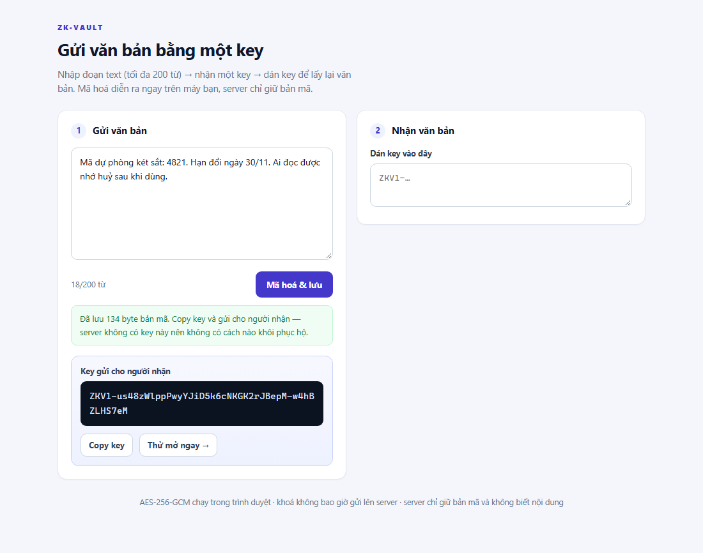
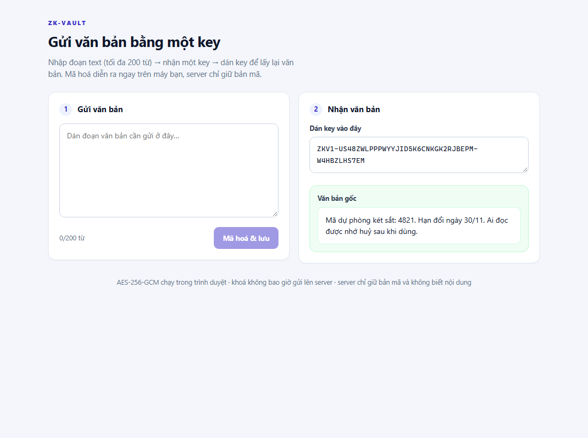

# ZK-Vault

Gửi một đoạn văn bản bằng **một key duy nhất** — không tài khoản, không mật khẩu, và server
không có khả năng đọc nội dung.

```
soạn text  ──►  mã hoá tại trình duyệt  ──►  server lưu bản mã  ──►  trả về key ZKV1-…
dán key    ──►  tìm bản mã theo key     ──►  giải mã tại trình duyệt  ──►  hiện lại text
```

## Chạy thử

```bash
node src/server.js
# ZK-Vault chạy tại http://127.0.0.1:8787
```

Không cần `npm install`. Server chỉ dùng module có sẵn trong Node 24:
`node:http`, `node:sqlite`, `node:crypto`.





## Điều gì khiến nó "zero-knowledge"

| Client giữ | Server giữ |
|---|---|
| key 32 byte (đưa cho người dùng) | `id` = ảnh một chiều của `authKey` |
| `encKey` — khoá mã hoá, **không bao giờ gửi đi** | bản mã (không giải mã được) |
| `authKey` — chỉ dùng để chứng minh quyền truy cập | thời điểm hết hạn |

Server không có `encKey` và không có key gốc. Dump toàn bộ database cũng chỉ thu được
ciphertext vô nghĩa.

## Cấu trúc

```
src/
├── crypto.js     # lõi: HKDF dẫn xuất khoá + AES-256-GCM
├── keycode.js    # key ZKV1-… : Base64URL, 43 ký tự
└── server.js     # HTTP API + SQLite, zero-dependency
public/
├── index.html    # giao diện hai cột: Gửi / Nhận
├── app.js        # luồng client
└── style.css
test/
├── keycode.test.js  # 10 test
├── crypto.test.js   # 19 test
├── server.test.js   # 13 test
└── e2e.cjs          # 12 kiểm tra trên Chrome thật
docs/               # tài liệu đọc hiểu dự án
```

## Tài liệu

| File | Nội dung |
|---|---|
| [01-kiến trúc](docs/01-kien-truc.md) | Các thành phần, luồng dữ liệu, ai giữ cái gì |
| [02-thuật toán](docs/02-thuat-toan.md) | HKDF, AES-256-GCM, định dạng gói tin — có ví dụ số thật |
| [03-bảo mật](docs/03-bao-mat.md) | Mô hình mối đe doạ: chặn được gì, không chặn được gì |
| [04-API](docs/04-api.md) | Đặc tả endpoint, mã lỗi |
| [05-đọc code](docs/05-doc-code.md) | Đi từng file, từng hàm, kèm số dòng |
| [06-kiểm thử](docs/06-kiem-thu.md) | Test làm gì và cách tự tay kiểm chứng |

## Kiểm thử

```bash
node --test test/keycode.test.js test/crypto.test.js test/server.test.js
node test/e2e.cjs        # cần Chrome hoặc Edge
```

## Giới hạn đã biết

- **Mất key là mất văn bản.** Không có khôi phục, không có hỗ trợ — đây là hệ quả trực tiếp
  của việc không cần tài khoản.
- **Ai có key là đọc được.** Key là chìa khoá vật lý, không phải mật khẩu.
- **Giới hạn 200 từ** đang chặn ở client. Muốn chắc chắn thì phải chặn cả ở server.
- Văn bản tự xoá sau **7 ngày**; server vẫn thấy kích thước, thời điểm gửi và IP.
